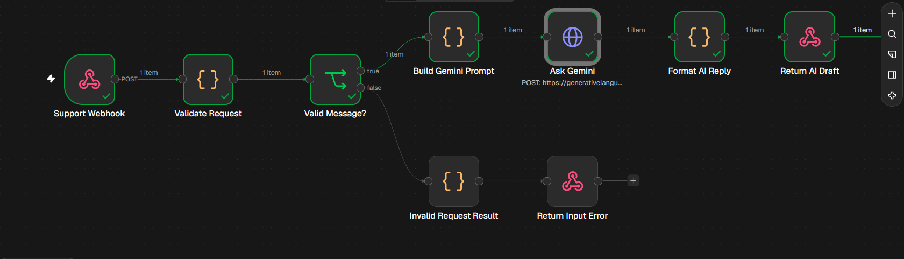
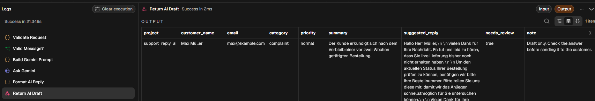

# AI Customer Support — Gemini Draft Assistant (n8n)

A practical **n8n + Google Gemini** workflow that receives customer messages through a webhook, validates the input, classifies the request, and prepares a **German-language support reply draft** for human review.

> **Human-in-the-loop:** This workflow creates a draft. It does **not** send emails or automatically reply to customers.

## Successful test

Tested locally on **10 November 2026** with a fictional delayed-delivery complaint. The main execution path completed successfully, including the Gemini request and the webhook response.



**Actual test result:**

- **Customer:** Max Müller (fictional example)
- **Category:** `complaint`
- **Priority:** `normal`
- **Summary:** `Der Kunde erkundigt sich nach dem Verbleib einer vor zwei Wochen getätigten Bestellung.`
- **Suggested reply:** A German draft acknowledging the delay and requesting the order number to investigate the delivery status
- **Needs human review:** `true`
- **Observed execution duration:** approximately 21.35 seconds (one local test; not a performance benchmark)



## Workflow overview

```text
POST /support-reply
       |
Support Webhook
       |
Validate Request
       |
Valid Message?
  |            |
  | no         | yes
  v            v
Invalid       Build Gemini Prompt
Request             |
  |             Ask Gemini (HTTP Request)
Return                  |
Input Error        Format AI Reply
                         |
                   Return AI Draft
```

## Tech stack

- **n8n:** workflow automation, webhook handling, branching, and response nodes
- **JavaScript:** input validation, prompt preparation, and output formatting
- **Google Gemini API:** message classification, summarization, and German reply generation
- **HTTP / JSON:** integration interface and structured output

## Features

- Validates incoming customer support requests before calling the model
- Uses a configurable prompt for categories, priority, summary, and suggested reply
- Returns structured fields such as `category`, `priority`, `summary`, `suggested_reply`, and `needs_review`
- Provides a separate response path for invalid input
- Requires human approval of every generated draft before customer communication

## Getting started

1. Import [`workflow.json`](workflow.json) into your local n8n instance.
2. Open **Ask Gemini** (HTTP Request node).
3. Set **Authentication** to **Generic Credential Type**, then **Header Auth**.
4. Create a Header Auth credential:
   - **Name:** `x-goog-api-key`
   - **Value:** your own Gemini API key from [Google AI Studio](https://aistudio.google.com/api-keys)
5. Select the credential and configure the request URL with a Gemini model **available to your API account**. Model availability changes; an older model name in an imported workflow may need updating.
6. Save the workflow. In **Support Webhook**, listen for a test event (or click **Execute workflow** in the editor).
7. Send a POST request to the test URL, shown below. The test webhook must be listening before the request; it generally handles one test call per activation.

### Example request (PowerShell)

```powershell
$body = @{
    customer_name = 'Max Müller'
    business_name = 'Mukryan'
    email         = 'max@example.com'
    message       = 'Guten Tag, ich habe vor zwei Wochen ein Produkt bestellt, aber die Lieferung ist noch nicht angekommen. Können Sie mir bitte helfen?'
} | ConvertTo-Json

$result = Invoke-RestMethod `
    -Uri 'http://localhost:5678/webhook-test/support-reply' `
    -Method POST `
    -ContentType 'application/json' `
    -Body ([System.Text.Encoding]::UTF8.GetBytes($body))

$result | ConvertTo-Json -Depth 10
```

An additional sample payload is available in [`example_request.json`](example_request.json).

## Response fields

| Field | Meaning |
| --- | --- |
| `project` | Workflow identifier |
| `customer_name`, `email` | Identifiers provided with the request |
| `category` | AI-assigned message type |
| `priority` | AI-assigned priority |
| `summary` | Short German summary |
| `suggested_reply` | Draft response in German |
| `needs_review` | Indicates a human must review the draft |
| `note` | Reminder to review before sending |

## Limitations and security

- The main success path has been verified with **one fictional complaint**. Other request categories and the invalid-input branch have not been demonstrated by the included screenshots.
- **This is a portfolio demo**, not a fully managed production helpdesk. Retries, monitoring, rate limiting, access controls, error handling for Gemini outages, and privacy controls should be added before production use.
- Do not commit API keys, real customer records, or confidential prompt/context data to a public repository. Exported workflows should be inspected before publishing.
- For real customer messages in the EU, assess the applicable GDPR requirements and data-processing arrangements before sending personal data to a third-party model.
- Model output can be inaccurate. A human should verify factual assertions before replying to customers.

## Project status

**Working demo:** local webhook-to-Gemini-to-draft flow successfully executed on 10 November 2026.
